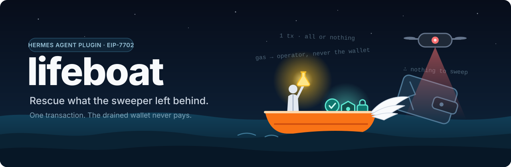

<p align="center"></p>

# lifeboat

A Hermes Agent plugin that rescues what a sweeper bot left behind in a drained EVM wallet.

Heh. So your private key leaked. Let's state the facts, because facts are all we need.

A bot emptied the wallet, and now it sits there watching. Send the wallet gas and the gas is gone
in seconds. Ten billion percent of the time. That is not bad luck, that is a loop with a sleep
interval. And because of it, everything that could not be moved yet is stuck: the airdrop you never
claimed, the vesting grant, the stake, the LP position, the NFT. You hold the key and you cannot
use it.

Most people stop here and call it hopeless. Wrong. It is a problem with exactly one missing
ingredient: a transaction the wallet does not have to pay for. So we build that.

## The trick, step by step

No magic. Just rules, followed in order.

1. A fresh **operator** wallet pays the gas. The sweeper has never seen it and has no reason to
   look at it.
2. Through **EIP-7702**, the drained wallet runs a small batch contract for one single transaction.
3. That one transaction does everything: claim, unstake, transfer, **all or nothing**, straight to
   a safe address you chose in advance.

The sweeper is waiting for gas to arrive. Gas never arrives. By the time there is anything to see,
there is nothing left to take. This is exhilarating.

## Where this came from

Not from a whiteboard. From two wallets that actually got drained.

The first rescue was a race: a token unlock, a sweeper bot parked on the wallet, and one
transaction that had to land in the very first block after the unlock. It did. The bot never moved.

The second was the real experiment: a swept wallet with positions still locked inside it, and no
way to pay for a single transaction. One EIP-7702 batch from a fresh operator pulled all of them
out at once.

Both were done by hand, with scripts, late at night, one careful step at a time. An experiment that
works twice is not a trick any more, it is a procedure. And a procedure can be written down so
nobody has to rediscover it under pressure. lifeboat is that procedure, with every safety check the
manual version only had in its author's head.

## The roadmap

Every great project starts with a roadmap. Here is yours, six steps from "drained" to "rescued".

| Step | Tool | What happens |
|---|---|---|
| 1. scan | `lifeboat_scan` | Lists what the wallet still holds on each chain. Read-only. |
| 2. plan | `lifeboat_plan` | Builds the ordered batch: claims and unstakes, then transfers to the safe. |
| 3. simulate | `lifeboat_simulate` | Dry-runs the batch against the live chain and estimates the gas. |
| 4. fund | you | Send a little gas to the operator address, from a wallet unrelated to the drained one. |
| 5. execute | `lifeboat_execute` | One EIP-7702 transaction, after you approve the exact text. |
| 6. sweep | `lifeboat_sweep_back` | Returns the unused operator gas to the safe address. |

`lifeboat_status` and the `/lifeboat` command show the setup, the operator, the plans and receipts.

One rule above all the others: **do not wake the bot.** Nothing touches the drained wallet on chain
before the rescue transaction itself. lifeboat never sends it gas, never pokes it to see whether a
sweeper is home, and reads everything else from public data. On a chain the sweeper has not found
yet, it gets zero warning. You only get one first move, so you do not waste it on an experiment.

## Gathering the materials

```
hermes plugins install <this repository> --enable
```

Three ingredients, set in the Hermes environment and never typed into the chat:

| Name | Meaning |
|---|---|
| `LIFEBOAT_VICTIM_KEY` | Private key of the drained wallet. It signs one authorization and nothing else. |
| `LIFEBOAT_SAFE_ADDRESS` | Where everything goes. A wallet the leaked key does not control. |
| `LIFEBOAT_ENABLE_EXECUTE` | `1` to allow the two tools that send transactions. Anything else keeps lifeboat read-only. |

Only have the recovery phrase, not the key? `python scripts/key_from_mnemonic.py <path to the Hermes
.env>` asks for the phrase at a hidden prompt, shows you the address so you can confirm it is the
drained wallet, and writes the key line itself. Neither the phrase nor the key is ever printed.

Optional plugin config `rpc`: a map from chain id to your own RPC URL.

The chain needs EIP-7702 and an RPC that accepts `eth_call` state overrides. Every chain below
answered a live probe for both, and `lifeboat_status` prints the list.

| Chains | Scan and sweep history |
|---|---|
| Ethereum, OP Mainnet, Gensyn, Unichain, Soneium, Ink, World Chain, Scroll | read from the explorer |
| Base, Arbitrum One, Robinhood Chain, Gnosis, Linea, Berachain, Sonic | not readable: name the tokens yourself |
| Testnets: Sepolia, Base Sepolia, OP Sepolia | read from the explorer |
| Testnet: Arbitrum Sepolia | not readable |

A rescue works on every one of them. Where the history is not readable, the explorer refuses
scripts or offers no such API, so the scan lists only the native balance there and a sweep on that
chain does not count as evidence. A sweep seen on any other chain still does. Let's be precise about
what has been proven. The plugin itself has made one real rescue on a mainnet, and the same
EIP-7702 batch was run by hand on another mainnet before the plugin existed. For most chains in the
table the evidence is the probe and the local test chain, not a mainnet transaction. Chains without
EIP-7702, zkSync Era among them, are out.

Requires Hermes 0.22 or later, with plugins loaded in process (the default) and the approval prompt
on. In yolo mode, with approvals off, in cron, `-q`, webhook and API sessions, and in the plugin host
process, the write tools refuse to run. A transaction nobody looked at is not science, it is gambling.

## What goes into a plan

- `transfer_erc20`, `transfer_nft` (ERC-721 and ERC-1155) and `transfer_native`: always to the safe.
- `call`: a claim, withdraw or unstake on another contract, written as a function signature and
  typed arguments, for example `withdraw(uint256,address)` with `["600000000000000000000", "<safe>"]`.

A `call` is deliberately narrow in this version. A reagent you cannot identify does not go in the
flask:

- Arguments are `address`, `bool`, `uintN`, `intN`, `bytesN` and flat arrays of them. No `bytes`,
  `string` or tuples, and no raw calldata, so routers, bridges and multicalls are out.
- An address argument must be the drained wallet, the safe address, or a token the same plan
  transfers. A recipient of a transfer function must be the safe.
- Approvals, permits and operator grants are refused, whoever they name.
- A plan needs at least one transfer step, so there is always an asset whose arrival is checked.

That still covers merkle airdrop claims, vesting releases, direct unstakes and withdrawals, and
functions that take a receiver. A fee-on-transfer token goes through a plan without `call` steps.

## Trust nothing, verify everything

Look at what this thing actually is: a tool that signs with a compromised key, on instructions
written by a language model. Only an idiot would trust that on faith. So lifeboat assumes the worst:
the text the agent reads may be hostile, it may talk the agent into calling any lifeboat tool with
any arguments, and it may turn the agent's other tools against lifeboat's own files.

Every one of those gets a countermeasure, not a hope.

| What could go wrong | What stops it |
|---|---|
| The agent names another recipient | No tool takes a recipient. The safe address comes from the environment. A `call` cannot name a foreign address. |
| A contract behaves in the dry run and steals in the real transaction | The batch carries the approved amounts and reverts as a whole when the safe would get less. |
| The plan is changed after you approved it | The handler sends only what matches the approval it just showed, once, within fifteen minutes. |
| A fake simulation or a planted operator key in the data directory | Simulations and approvals live in memory. Operator key files are sealed and authenticated under the victim key. |
| A transaction sent with nobody watching | Every send needs the Hermes approval prompt, with a fresh rule key so "always allow" never covers it. |
| A key reaching the model or a log | Keys are read from the secret scope, never passed as arguments, scrubbed from every output and registered with Hermes redaction. |
| "Rescue confirmed" when nothing moved | The result is read from the chain after the receipt: every planned asset must have arrived. |
| The tool used as a drainer | See the next section. |

### A lifeboat, not a crowbar

Think about it for one second. A tool that pulls staked and vesting assets out of any wallet whose
key you happen to hold is a drainer with better manners. Not building that.

So lifeboat runs only when the wallet has a sweep on record: gas that arrived and left again to
another address within five minutes, at least twice. The record comes from the chain explorer,
read-only. And since a leaked key is leaked on every chain at once, a sweep on one chain qualifies
the wallet on all of them. That is exactly what lets you save the asset the bot has not found yet.

There is no switch to turn this off. If nobody is sweeping your wallet, you do not need a lifeboat.
Send it gas and walk your assets out like a normal person.

Now the honest part. This proves that a sweep happened. It does not prove who owns the wallet,
because the owner and the thief hold the same key, and someone determined can stage the pattern. It
stops lifeboat from being the first thing that empties an untouched wallet. Nothing more is claimed.
One more error bar: a busy wallet that often receives funds and sends them on within minutes can
match the pattern without any bot involved. The record is quoted in the approval text so you can
judge it yourself.

### Where the science runs out

A result without its error bars is a lie, so here are the error bars:

- A call target that is hostile in its own code can pay an address fixed inside it. lifeboat
  guarantees that the planned assets reach the safe in the approved amounts, or nothing happens.
- A token the wallet holds that is not in the plan is not watched. Put everything the scan finds
  into the plan.
- After a rescue the wallet stays delegated to the batch contract, which only the operator can
  drive. The leaked key still controls the wallet. That wallet is finished. Never use it again.
- On a chain with a public mempool, the rescue is visible for a moment before it lands.
- Seven chains have no explorer lifeboat can read (see the table above), so their tokens are not
  listed by the scan and sweeps there do not count as evidence. Sweeps on another chain do.
- Scroll's data fee is not part of the gas estimate. Fund the operator with a margin there.

Two security reviews went through this code, and their findings and fixes are in
`docs/security-review.md`. Read it. Checking the work is the fun part.

## What it does on your machine

No surprises in the lab:

- Network: the RPC of each chain you use, and the Blockscout API of each chain for the scan and
  the sweep history. Nothing else. No telemetry.
- Files, all under the plugin data directory: plans, receipts, the address of the deployed batch
  contract, the stored sweep evidence, and one file per operator wallet. The operator key in it is
  sealed under a secret derived from the victim key, so recovering an operator by hand needs that key.
- No background threads.
- Shipped EVM bytecode: `contracts/artifacts.json`, built from `contracts/src` with the settings
  recorded in the file. `python scripts/build_artifacts.py` rebuilds it with Foundry, and a test
  fails when the shipped file differs from the source. Reproducible, or it does not count.

## Run the experiment yourself

```
python -m venv .venv
.venv/bin/pip install "web3>=7.10,<8" "eth-account>=0.13.6,<0.14" pytest
.venv/bin/python -m pytest
```

The tests need Foundry (`anvil`, `forge`) on the path. They run every rescue against a local Prague
chain with mock tokens, a staking pool, a vesting contract and a sweeper bot that really does take
the gas. `demo/README.md` walks through the same thing on Base Sepolia, start to finish.

Get excited. The wallet is gone, but what is inside it is not.

MIT license, see `LICENSE`.
